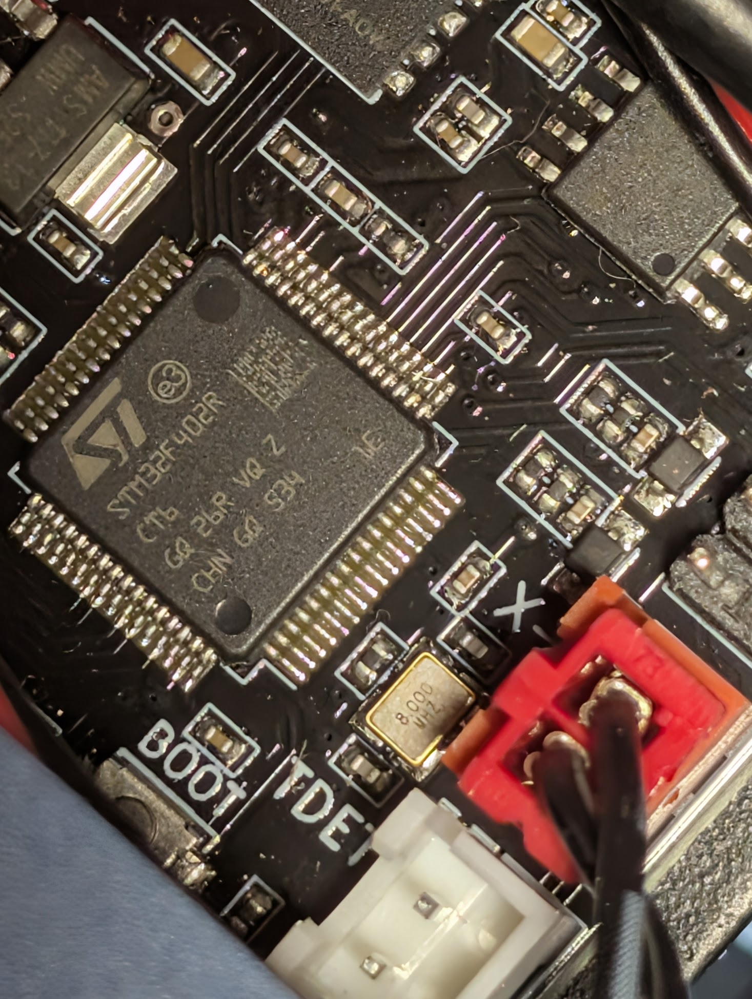

# SculpFun iCube (QV3 board, 2024) firmware reverse engineering

This repo documents the extraction and analysis of the firmware from a
**SculpFun iCube** laser engraver, 2024 hardware revision (**QV3** mainboard).



The 2024 iCube is **not** based on an ESP32 (unlike the 2023 MV/QV revisions).
It uses an **STM32F4-class Cortex-M4** MCU (marked `STM32F402RG T6`, bootloader
PID `0x423`), an external **Feasycom FSC-BT836** Bluetooth module, and a CH340
USB-serial bridge wired to the MCU's USART1.

## Firmware images

| Image | Bluetooth | Flame auto-off | ROLLER/FlCk fields | Watchdogs | Use when |
|---|---|---|---|---|---|
| `stm32_flash.bin` | ✔ | ✔ | ✔ | — | you want the device exactly as shipped (recovery baseline) |
| `stm32_flash_noflame.bin` | ✔ | ✘ fixed | ✔ | — | **recommended** — only the root-cause fix (4-byte NOP); maximum stock fidelity |
| `stm32_flash_bt_disabled.bin` | ✘ severed | ✔ | ✔ | — | you want the radio's serial input muted but no other changes |
| `stm32_flash_noflame_watchdog.bin` | ✘ severed | ✘ fixed | ✘ removed | IWDG + stall + HardFault | you want self-recovery from any future hang; radios off, minimal reports |

"Flame auto-off" is the vendor safety task that false-triggers on machines
without the optional flame sensor and bricks the board until a power cycle —
see `NOTES.md` for the full analysis. All images flash the same way:
`python3 scripts/flash_wait.py <image>` (BOOT+RESET dance, then power-cycle).

## Repo layout

| Path | Contents |
|---|---|
| `firmware/` | the four flash images compared in the table above |
| `decomp/all_stm32_qv3.c` | Ghidra decompilation (711 functions) |
| `scripts/raw_dump.py` | STM32 UART-bootloader flash dumper (worked on this device) |
| `scripts/flash_wait.py` | waits for the bootloader, then flashes + verifies an image |
| `scripts/flash_writer.py` | selective-sector writer (erase command NACKs on this board; kept for record) |
| `scripts/usbmon_sniff.py` | Linux usbmon packet sniffer for the CH340 link |
| `scripts/ghidra/DecompileAll.java` | Ghidra headless script used for the decompile |
| `docs/photos/` | mainboard photos taken during the process |
| `NOTES.md` | full reverse-engineering write-up |

## How the dump was made

The board exposes two silkscreened buttons, **BOOT** and **RESET**. Holding
**BOOT** while tapping **RESET** boots the STM32 into its ROM UART bootloader
on the same CH340 port (`/dev/ttyUSB0`, 115200 8E1):

```bash
python3 scripts/raw_dump.py        # 0x7F handshake → 256 KB read from 0x08000000
```

See `NOTES.md` for the full story, firmware contents, the job-wedge root
cause (vendor flame auto-shutdown false-triggering), and reproduction steps.
